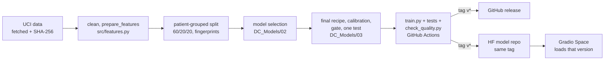

# Diabetes Hospital Readmission — which patients to follow up first

NOVA IMS, Enterprise Data Science Bootcamp 2026, group project.

**Decision.** At discharge, the Director of Care Quality of a hospital network must decide
which diabetic patients get extra follow-up, with capacity for only some of them.
**Answer of the project.** A calibrated model ranks the discharges by their risk of an
inpatient readmission within 30 days: following up the riskiest 10% reaches **565 of
2,216 readmissions** on test patients the model never saw, **229 more than the LACE
clinical score** and 343 more than choosing at random.

| | Link |
|---|---|
| Live demo (Gradio Space) | `https://huggingface.co/spaces/davidecorbo/diabetes-readmission-app` |
| Model repository and card | `https://huggingface.co/davidecorbo/diabetes-readmission-model` · [docs/model_card.md](docs/model_card.md) |
| Every methodological decision | [docs/decision_log.md](docs/decision_log.md) (D-001 to D-032) |
| Course brief and project plan | [docs/](docs/) |

## Results

Measured **once** on the test patients (19,802 discharges of 13,998 patients, 20% of the
patients, held out from every fit and choice; decision log D-032):

| Ranking method | PR-AUC | ROC-AUC | Readmissions reached with 10% capacity |
|---|---:|---:|---:|
| **XGBoost, calibrated (final)** | **0.238** | **0.674** | **565** |
| Logistic regression | 0.218 | 0.667 | 523 |
| LACE index (clinical score) | 0.140 | 0.571 | 336 |
| Random order | 0.112 | 0.500 | 222 |

- **Calibrated:** mean estimated risk 11.5% against 11.2% observed; every risk decile within 1.8 pp.
- **Tiers by capacity:** High = riskiest 10% of discharges (28.8% of them are readmitted, 25% of all readmissions); High + Medium = 30% of discharges, 52% of readmissions.
- **Quality gate** fixed before the test was opened: passed on all four lines.
- **Fairness:** calibration holds in every race, age and gender group with 500+ test discharges; the High tier reaches 21% (80 and over) to 34% (under 50) of each group's readmissions.
- **Limits:** the model ranks risk, it does not prove that follow-up prevents readmissions; 1999-2008 US data; readmissions outside the network are recorded as "no". See the [model card](docs/model_card.md).

The figures of the report and of the app are in [reports/figures/](reports/figures/), in the IBCS notation.

## How it works



1. **Data audit and cleaning** (`notebooks/`, `src/data_prep.py`, `src/features.py`): `?` is missing, `None` in the lab tests is "not measured" (D-001); death and hospice discharges removed because their outcome cannot be observed (D-004, D-005); diagnoses grouped as in Strack et al. (2014); every rule is a row-by-row function tested in `tests/`.
2. **No leakage by patient**: 71,518 patients have 101,766 encounters, so every split and cross-validation is grouped on `patient_nbr` (D-010, D-017); everything learned from data sits inside a scikit-learn `Pipeline` (D-014).
3. **Model selection** (`DC_Models/02_model_exploration`): linear models, EBM, random forests, four boosting libraries, a survival model (XGBoost AFT), a Keras network and an ensemble, tuned on grouped CV of the training rows and compared on validation (D-015, D-019).
4. **Final model** (`DC_Models/03_final_model`): tuned XGBoost, isotonic calibration (option chosen on validation before the test), tiers by capacity, baselines, TreeSHAP explanations, fairness audit, then the test set once (D-032).
5. **Pipeline** (`.github/workflows/ml-pipeline.yml`, course W9-W10): data tests, `train.py`, model tests, quality gate on every push; a `v*` tag publishes the release, the Hugging Face model and the Space.

## Repository

| Path | What |
|---|---|
| `src/` | Shared code imported by notebooks, `train.py` and the app: `data_prep.py` (loading), `features.py` (cleaning, derived features, split, fingerprints), `preprocessing.py` (pipelines), `models.py` (AFT, CatBoost, Keras wrappers), `evaluation.py` (metrics), `calibration.py` (calibration, capacity cut-offs), `final_model.py` (the final recipe, gate, LACE baseline), `scoring.py` (risk, tiers, reasons for new discharges), `ibcs.py` (IBCS charts) |
| `notebooks/` | `01_eda_raw`, `02_data_cleaning` (step by step, frozen split), `03_eda_target` (target rates on training rows) |
| `DC_Models/` | `01_cleaning_variants` (cleaning alternatives tested), `02_model_exploration` (model families), `03_final_model` (final model, single test evaluation, figures) |
| `LA_Models/` | The first modelling stream (Luís); its test evaluation of 2026-10-14 is recorded in D-031 |
| `train.py`, `check_quality.py`, `scripts/fetch_data.py` | The pipeline run by GitHub Actions |
| `space/` | The Gradio app (`app.py`) and its Space configuration |
| `tests/` | `test_src.py` (rules and leakage, no data needed), `test_data.py` (the raw file), `test_model.py` (the trained model) |
| `docs/` | Decision log, model card, course brief, project plan |
| `reports/` | Experiment logs (`experiments-readmission*.csv`), `final_test_metrics.json`, figures, the clean profiling report |

The `.py` files next to the notebooks are their Jupytext copies (code and text, no
outputs), for readable diffs.

## Setup

Python 3.13 and a virtual environment in `.venv/`; the full steps for Windows and
macOS are in **[SETUP.md](SETUP.md)**.

```powershell
py -3.13 -m venv .venv
.\.venv\Scripts\Activate.ps1
pip install -r requirements.txt       # everything: notebooks, all model families
python scripts/fetch_data.py          # data/diabetic_data.csv and IDS_mapping.csv, checked by SHA-256
python -m unittest                    # 38 tests (the data and model tests run when the files exist)
```

`requirements.txt` is the full development environment; `requirements-pipeline.txt`
pins the few libraries of the pipeline to the versions that produced every number.

## Reproduce the results

| Step | Command | Time |
|---|---|---|
| Cleaning, step by step | open `notebooks/02_data_cleaning.ipynb`, Run All | ~1 min |
| Model families | `DC_Models/02_model_exploration.ipynb`, Run All (lower `N_ITER` to go faster) | ~45 min |
| Final model, figures | `DC_Models/03_final_model.ipynb`, Run All | ~3 min |
| Published model | `python train.py` then `python check_quality.py` | ~1 min |
| The app, locally | `pip install gradio==6.32.0` then `python space/app.py` → http://127.0.0.1:7860 | |

`train.py` must give the same test metrics as `03_final_model` (checked by
`tests/test_model.py`). The split is identical on every computer: the fingerprints of
the three sets are printed and asserted (train `1e2fece0c48e`, validation
`920e3a74bf6e`, test `fe3f135ba61d`).

After changing a notebook, regenerate its `.py` copy:

```powershell
python -m jupytext --to py:percent --opt notebook_metadata_filter=-all --opt cell_metadata_filter=-all DC_Models/03_final_model.ipynb
```

## Deployment

The schema of the course (W10): **one tag, one version everywhere**. The GitHub
release, the Hugging Face model tag and the version the Space loads are the same.

One-time setup:

1. On Hugging Face, create the Space `diabetes-readmission-app` by hand: SDK **Gradio**, template **Blank**, hardware **ZeroGPU** (free tier; the app declares the @spaces.GPU marker the runtime requires, and predictions run on CPU without using the GPU quota).
2. Create a Hugging Face token with **Write** access and store it in GitHub: *Settings → Secrets and variables → Actions → New repository secret*, name `HF_TOKEN`.

Release:

```powershell
git tag v1.0
git push origin v1.0
```

The workflow then tests, trains, checks the gate, creates the GitHub release, uploads
the model and its card to `davidecorbo/diabetes-readmission-model` with tag `v1.0`, and
uploads `space/` (with the shared modules of `src/` and the figures) to the Space. A tag
cannot be reused: after a failure, fix and push `v1.1`.

## Responsible use

- **Of the model:** an educational prototype, not a medical device. It ranks risk for
  follow-up with a clinician reviewing every list; it must not be used to deny care or
  decide without review (model card: intended and excluded uses).
- **Of AI assistants in this project:** Claude Code (Anthropic) helped write and review
  code, documentation and checks. Every number in the report, the slides and the app was
  produced by the code of this repository and checked against its output files
  (`reports/final_test_metrics.json`, `models/metrics.json`); every methodological
  choice is recorded with its evidence in the decision log, and the team reviewed and
  is accountable for all of it.

## Next steps

From the open entries of the decision log: statistical comparison of models with
patient-level bootstrap (D-020), nested grouped CV (D-021), decision curve analysis
(D-022), ranking objectives tuned on the capacity (D-023), comorbidity features
(D-024), the three-level outcome (D-025), conformal risk intervals (D-027), fairness
by intersections of groups (D-028), and monitoring the calibration on new discharges.
